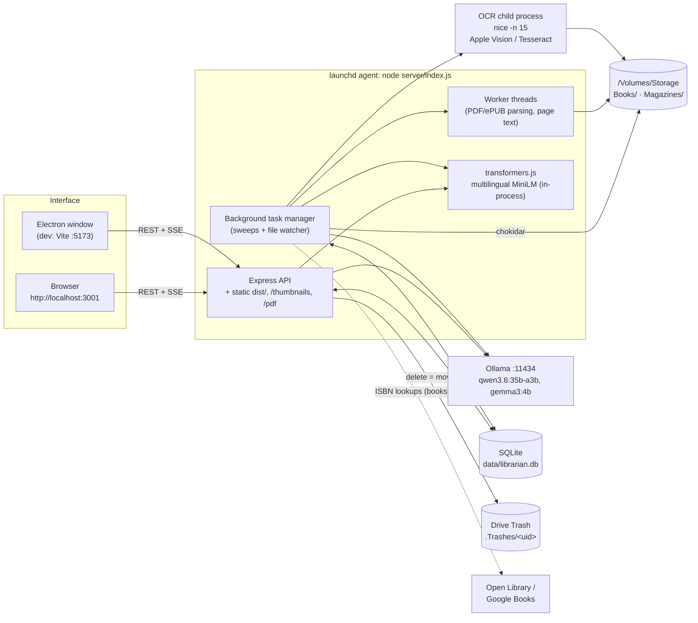
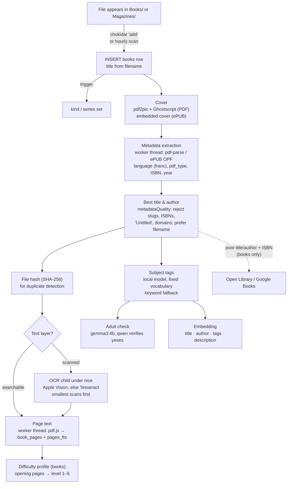
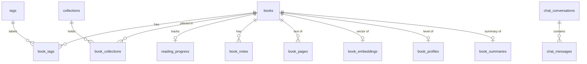
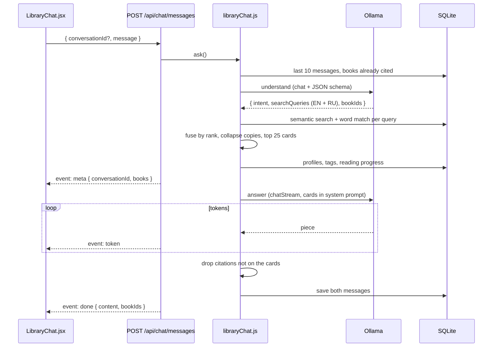

# Architecture

How Bibliotheka is put together: the processes that run, how a file on disk
becomes a searchable, tagged, recommendable entry, where everything is stored,
and how the interface talks to it. For what the app does from a reader's point
of view see the [README](../README.md); for how it got here, the
[development plan](../DEVELOPMENT_PLAN.md).

- [Principles](#principles)
- [System overview](#system-overview)
- [Repository layout](#repository-layout)
- [The server](#the-server)
- [Library folders: books and magazines](#library-folders-books-and-magazines)
- [Ingestion pipeline](#ingestion-pipeline)
- [Background tasks](#background-tasks)
- [Data model](#data-model)
- [Search](#search)
- [Local AI](#local-ai)
- [Library chat](#library-chat)
- [The interface](#the-interface)
- [Electron](#electron)
- [Security](#security)
- [Deleting and file safety](#deleting-and-file-safety)
- [Configuration](#configuration)
- [Logging](#logging)
- [Testing and CI](#testing-and-ci)
- [Design decisions](#design-decisions)

## Principles

- **Local first.** The catalogue, the page text, the embeddings and every
  model run on the user's machine. There are no accounts or API keys, and
  nothing leaves the laptop except optional ISBN lookups against Open Library
  and Google Books.
- **The library looks after itself.** A file dropped into the books or
  magazines folder gets a cover, metadata, full text, tags, an embedding and
  a difficulty profile without anyone asking. Each of those is a background
  sweep that picks up whatever is missing, so a crash, a restart or an
  unmounted drive only delays the work.
- **Degrade, don't fail.** Ollama may not be running; the Ollama client then
  returns `null` and every caller has a fallback (keyword tagging, an
  extractive summary, an "unavailable" notice). A missing magazines folder
  just means an empty section.
- **One database file.** SQLite holds everything the app knows. The files on
  disk are the source of truth for the books themselves; the database is
  rebuilt from them by the scanners when needed.

## System overview



| Process | What it is | Why it is separate |
|---|---|---|
| **Server** (`server/index.js`) | Express 5 API, static UI, background task manager. Runs as the launchd agent `com.khodjayevb.bibliotheka`, plain `node` | Always on, so new books are ingested whether or not a window is open |
| **Worker threads** (`bookProcessorPool` → `bookProcessorWorker`) | pdf-parse, ePUB parsing and pdf.js page extraction | Parsing a large PDF blocks for seconds; on the main thread every API request queued behind it |
| **OCR child** (`ocrChild.js`) | One scanned book per process, started under `nice -n 15` | Minutes of CPU per book and days of backlog; the kernel gives it only spare time, and a crash costs one book |
| **Ollama** | Local model server | Shared by tagging, summaries, Q&A, compare, profiling and chat |
| **Embedding model** | `Xenova/paraphrase-multilingual-MiniLM-L12-v2` via `@huggingface/transformers`, quantised (`q8`), 2 ONNX threads, cached in `data/models/` | Milliseconds per book, so it runs in the server process |
| **Interface** | React 19 + Vite + Tailwind, built to `dist/` | Served by the agent at `:3001`, or loaded into Electron |

## Repository layout

```
Bibliotheka/
├── server/
│   ├── index.js               Express app: security, routes, /pdf, static UI, logging
│   ├── database/init.js       Opens SQLite, creates tables, runs migrations
│   ├── routes/                One router per API area (see "The server")
│   └── services/              Everything else; one concern per file:
│       ├── backgroundTaskManager.js   Scanner, watcher and every periodic sweep
│       ├── libraryFolders.js          Books vs magazines folders; kind/series classifier
│       ├── bookProcessorPool.js / bookProcessorWorker.js / pageExtraction.js
│       ├── pdfProcessor.js, epubProcessorImproved.js, pdfContentExtractor.js
│       ├── thumbnailGenerator.js      pdf2pic + GraphicsMagick/Ghostscript covers
│       ├── visionOcrExtractor.js, pdfOcrExtractor.js, ocrChild.js
│       ├── metadataQuality.js         Is this a real title/author? Best title chooser
│       ├── bookMetadataEnricher.js    Open Library / Google Books by ISBN
│       ├── ollamaClient.js            The only way to reach Ollama
│       ├── aiTagger.js, tagVocabulary.js, autoTagger.js
│       ├── embeddingService.js        Embeddings, semantic search, Similar Books
│       ├── bookProfiler.js            Level/audience/prerequisites per book
│       ├── libraryChat.js             The chat engine
│       ├── bookQA.js, crossBookCompare.js, queryInterpreter.js, summaryService.js
│       ├── enhancedSearchService.js, fullTextSearch.js, ftsQuery.js
│       ├── duplicateDetector.js, bookRemoval.js, smartCollections.js
│       └── ocrQueueManager.js, fileWatcher.js (manual-scan API only)
├── src/
│   ├── App.jsx                All view state; loads books; wires the modals
│   ├── components/            Sidebar, cards, details, readers, chat, dialogs…
│   ├── hooks/useDarkMode.js
│   └── utils/issueOrder.js    Newest-first ordering of magazine issues
├── electron/                  main.js (window, menu, prod server), preload.js (bridge)
├── scripts/                   Maintenance scripts; scripts/diagnostics/ one-off checks
├── tests/                     Jest; tests/setup.js points at a throwaway database
├── tools/visionocr/           Swift CLI for Apple Vision OCR, compiled on first use
├── launchd/                   The always-on agent definition
├── public/thumbnails/         Generated covers (served at /thumbnails)
├── data/                      librarian.db, test copies, data/models/ (embedding model)
└── docs/                      This file and the page-search notes
```

## The server

### Request pipeline

1. **Host check.** While listening on loopback (`HOST` defaults to
   `127.0.0.1`), a request whose `Host` is not `localhost`, `127.0.0.1` or
   `[::1]` gets `403 Forbidden host`. This stops DNS rebinding.
2. **Origin check.** A request carrying an `Origin` other than the app's own
   (`http://<host>`) or the Vite dev server (`:5173`) gets
   `403 Forbidden origin`.
3. `cors({ origin: true })`, `express.json()`, `express.urlencoded()`.
4. Static `public/` (covers at `/thumbnails/...`).
5. `/pdf/<absolute path>` serves `.pdf` and `.epub` only, and only if the
   file's realpath is inside the books or magazines folder.
6. `/api/*` routers.
7. Static `dist/` (the built interface), then the 404 handler.

Requests are logged at `debug` level only (`LOG_LEVEL=debug`); they used to
be 99.8% of the log.

### API

| Mount | Router | Purpose | Main endpoints |
|---|---|---|---|
| `/api/books` | `books.js` | Catalogue | `GET /` (filters: `search`, `tags`, `author`, `language`, `fileType`, `kind`, `series`, `sortBy`, `limit`), `GET /:id`, `PUT /:id`, `DELETE /:id`, `GET /series`, `GET /sections`, `DELETE /bulk/delete`, `POST/DELETE /bulk/tags`, `PUT /bulk/update`, `POST /:id/enrich`, `POST /:id/thumbnail` |
| `/api/scan` | `scan.js` | Manual scan of both folders, watcher control | `POST /`, `GET /config`, `POST /watch/start` |
| `/api/process` | `process.js` | Re-run metadata extraction | `POST /book/:id`, `POST /batch` |
| `/api/tags`, `/api/categories` | | Tag and category CRUD | |
| `/api/collections` | `collections.js` | Shelves; suggested shelves | `GET /`, `GET /:id`, `POST /:id/books`, `GET /suggest`, `POST /suggest/create` |
| `/api/progress` | `progress.js` | Reading progress and stats | `PUT /books/:id/progress`, `GET /reading/all`, `GET /reading/stats` |
| `/api/search` | `search.js` | Full-text search over pages | `GET /enhanced`, `GET /books/:id/occurrences`, `GET /books/:id/heatmap`, index maintenance |
| `/api/search` | `semanticSearch.js` | Embeddings | `GET /semantic`, `GET /hybrid`, `GET /similar/:bookId`, `GET /embeddings/stats` |
| `/api/ocr`, `/api/ocr-queue` | | OCR status and the manual queue | |
| `/api/duplicates` | `duplicates.js` | Find and merge duplicates | `GET /`, `POST /merge`, `DELETE /remove` |
| `/api/ai-tags` | `aiTags.js` | Model tagging; query interpreter | `POST /tag/:bookId`, `GET /vocabulary`, `GET /interpret?q=` |
| `/api/auto-tags` | `autoTags.js` | Keyword tag suggestions | |
| `/api/ask` | `ask.js` | Ask one book a question | `GET /:bookId/available`, `POST /:bookId` |
| `/api/compare` | `compare.js` | How several books explain a topic | `GET /?topic=` |
| `/api/summaries` | `summaries.js` | Book summaries | `GET /:bookId`, `POST /:bookId/generate` |
| `/api/chat` | `chat.js` | Library chat | `GET /status`, `GET /conversations`, `GET/DELETE /conversations/:id`, `POST /messages` (server-sent events) |
| `/api/preferences` | `preferences.js` | Hide adult content, default view and sort | |

## Library folders: books and magazines

`server/services/libraryFolders.js` is the one place that knows the folders:

| Kind | Folder | Default |
|---|---|---|
| `book` | `BOOKS_FOLDER` | `/Volumes/Storage/Books` |
| `magazine` | `MAGAZINES_FOLDER` | `/Volumes/Storage/Magazines` |

Books and magazines share the `books` table and every pipeline. They differ in
two columns:

- **`kind`**: `book` or `magazine`, from the folder the file is in.
- **`series`**: for a magazine, the folder directly under the magazines
  folder. For `Magazines/The New Yorker/Oct 12.pdf` that's "The New Yorker".
  A file loose in the magazines folder has no series.

Rows are inserted by several paths: the scanner, the watcher, the manual scan
and the add-a-book endpoint. So classification is done by a SQLite trigger
(`books_classify`, `AFTER INSERT`) rather than in any of them. The trigger is
rebuilt on every start, because the folder can change, and existing rows are
reclassified at the same time. Moving the magazines folder therefore needs no
migration.

What magazines skip:
- The Open Library and Google Books lookups. Asked about an issue, those
  services answer with whichever book shares a word of its title.
- Difficulty profiling.

## Ingestion pipeline



Each box is a separate sweep over "rows that don't have this yet", so the
steps don't depend on each other's timing. A book shows up in the grid as soon
as its row exists. Cards then flag whatever is still pending: *Unscanned*,
*Untagged*, *No text*.

## Background tasks

All in `backgroundTaskManager.js`. They are started unless
`BACKGROUND_TASKS=off`, which is the default for any database other than
`data/librarian.db`, so a test copy is never refilled from disk. A sweep that
finds more work schedules itself again a second later instead of waiting out
its interval.

| Task | Interval (first run) | Batch | What it does |
|---|---|---|---|
| File watcher | live | — | chokidar on both folders; adds new files, removes deleted ones. Ignores removals while a folder is unmounted, so an unplugged drive doesn't empty the library |
| Scan | hourly (at start) | all | Walks both folders for files the watcher missed |
| Process | 30 s | 10, on `PROCESSOR_WORKERS`=2 threads | Covers and metadata extraction for new rows |
| Thumbnails | 60 s | `THUMBNAIL_BATCH_SIZE`=25, 3 at once | Covers still missing |
| Hash | 5 min (20 s) | 50 | SHA-256 for rows from before hashing existed |
| Enrich | 5 min (15 s) | 25 | Books with a poor title/author and an ISBN, from Open Library / Google Books |
| Tag | 2 min (30 s) | `TAG_BATCH_SIZE`=20 | Untagged books, then the adult-content check |
| Index | 60 s (45 s) | 10 | Page text for books that have none |
| OCR | 2 min (90 s) | 1 | One scanned book in a `nice`d child process, fewest pages first. `OCR_BACKGROUND=off` disables it |
| Embed | 2 min (60 s) | `EMBED_BATCH_SIZE`=100 | Books without an embedding from the current model and recipe. A brand-new untagged book waits up to a day for its tags |
| Embedding check | hourly | all | Re-embeds books whose title, tags or description changed |
| Profile | 5 min (90 s) | `PROFILE_BATCH_SIZE`=20 | Difficulty profiles for books (not magazines). Skips a pass while tagging runs, since both use Ollama |

## Data model

SQLite in WAL mode, opened through better-sqlite3, which enforces foreign keys:
deleting a `books` row cascades to everything that refers to it. The file is
about 13.5 GB, almost all page text: `book_pages` and its full-text index
`pages_fts` hold about 1.7 million pages.



| Group | Tables | Notes |
|---|---|---|
| Catalogue | `books` | One row per file. Identity is `file_path` (unique). Also `file_hash`, `kind`, `series`, extracted metadata (`title`, `author`, `language`, `isbn`, `publisher`, `publication_year`, `description`, `page_count`, `pdf_type`), processing state (`thumbnail_path`, `indexed_at`, `ocr_status`, `adult_checked`, `is_adult`, `needs_review`) |
| Organisation | `tags`, `book_tags`, `collections`, `book_collections`, `categories`, `book_categories` | Tags come from a fixed vocabulary of 83 subjects. Collections are shared by books and magazines |
| Reading | `reading_progress`, `book_notes`, `user_preferences` | Progress is saved by the reader as pages turn |
| Text and search | `book_pages`, `pages_fts` (FTS5), `books_fts` (FTS5), `search_occurrences` | FTS tables have no foreign keys; see [Design decisions](#design-decisions) |
| AI | `book_embeddings`, `book_profiles`, `book_summaries` | Each row records the model and recipe that made it (`model_name`), so changing either redoes the work and never mixes two kinds |
| Chat | `chat_conversations`, `chat_messages` | Messages keep the ids of the books they cite |
| OCR | `ocr_queue` | The manual OCR queue; the background OCR sweep works from `books.ocr_status` |

Tables are created by `server/database/init.js`, or by the service that owns
them (embeddings, profiles, summaries, chat), with `CREATE TABLE IF NOT
EXISTS`. Columns added later are applied by `ALTER TABLE` checks at startup.

## Search

| Layer | Where | How |
|---|---|---|
| Grid filter | Client (`App.jsx`) | The whole section is loaded once (up to 100,000 rows); search box, tags (all must match), author, type, language, sort and the adult preference filter in memory |
| Ask (header) | `queryInterpreter.js` | The local model turns "russian books about business added recently" into those filters, shown so they can be adjusted |
| Full text | `enhancedSearchService.js` | FTS5 over `pages_fts`, joined to `books`; hits by page with snippets, occurrence counts and a per-book heatmap |
| Semantic | `embeddingService.js` | 384-dimensional vectors, brute-force cosine over every row (a few milliseconds at this size). Multilingual: a Russian query finds English books and back |
| Hybrid | `embeddingService.hybridSearch` | Weighted semantic and keyword scores |
| Similar Books | `findSimilarBooks` | Nearest neighbours within the same section |

`ftsQuery.toMatchQuery` reduces typed prose to quoted OR terms that FTS5 will
accept; a bare question mark or hyphen would otherwise be an FTS5 syntax
error.

## Local AI

Every model call goes through `ollamaClient.js`:

| Method | Ollama API | Use |
|---|---|---|
| `generateJSON(prompt, schema)` | `/api/generate`, `format: schema` | Tagging, adult check, profiles, Q&A, interpretation: output constrained to a JSON schema, so it always parses |
| `generateText(prompt)` | `/api/generate` | Summaries |
| `chat(messages, {format})` | `/api/chat` | The chat's "understand" step |
| `chatStream(messages, {onToken, signal})` | `/api/chat`, `stream: true` | Chat answers, token by token; idle timeout; abortable |

All of them send `think: false` (reasoning models otherwise spend their
budget thinking) and return `null` instead of throwing when Ollama is down.
Availability is probed with a 3-second request and cached for a minute.

| Task | Model | Notes |
|---|---|---|
| Tagging | `OLLAMA_MODEL` (qwen3.6:35b-a3b) | Up to 3 tags from the vocabulary; aliases fold near-misses ("postgres" → `databases`). Misses go to `OLLAMA_TAG_FALLBACK_MODEL`; without Ollama, keyword tagging |
| Adult check | `OLLAMA_ADULT_MODEL` (gemma3:4b), verified by `OLLAMA_VERIFY_MODEL` | Hiding a book is a visible mistake, so a flag needs both models to agree |
| Ask a book | `OLLAMA_MODEL` | Retrieves the book's best-matching pages by FTS5. Answers only from them, citing pages; a cited page that wasn't retrieved is dropped; says "not answered by this book" otherwise |
| Compare across books | `OLLAMA_MODEL` | Ranks books by how many pages teach the topic, one title per book, and shows each book's best passage |
| Summaries | `SUMMARY_MODEL` or `OLLAMA_MODEL` | Single pass, map-reduce, or sampled, by length. An extractive excerpt without Ollama |
| Metadata repair | `OLLAMA_MODEL` | Titles and authors read off the front matter (`scripts/repair-with-ai.js`) |
| Difficulty profiles | `PROFILE_MODEL` or `OLLAMA_MODEL` | See below |
| Library chat | `CHAT_MODEL` or `OLLAMA_MODEL` | See below |
| Embeddings | transformers.js, not Ollama | `paraphrase-multilingual-MiniLM-L12-v2`, about 145 MB, downloaded once |

Using one model for every task means it stays loaded. qwen3.6:35b-a3b is a
mixture-of-experts model with about 3B parameters active per token; it needs
about 24 GB of RAM. On a smaller machine set `OLLAMA_MODEL=gemma3:4b`.

### Difficulty profiles

`bookProfiler.js` gives the model a book's title, author, year, pages,
language, tags, description and its opening pages (pages 1–15, up to 6,000
characters: contents, preface, "who this book is for"). The model returns:

- `level` 1–5: first contact, beginner, intermediate, advanced, expert/internals
- `kind`: intro, tutorial, practical, reference, cookbook, deep-dive, internals, or other
- `audience`, `prerequisites`, `topics` and a one-line `summary`, all in English

The prompt is calibrated with anchors such as "Первое знакомство" → 1 and
"изнутри" → 5, and the output is validated and clamped.

A profile's key is `model#profile-vN`; changing the model or the prompt
re-profiles the library. A book the model can't read is recorded with no level,
so it isn't retried every pass. A book is never marked failed while Ollama is
down. Profiling takes about 6 seconds a book.

## Library chat



1. **Understand.** The model restates the question as 1–4 searches in English
   and Russian. Most of the library is Russian, and the `postgresql` tag is
   folded into `databases`, so tags alone can't find things. Follow-ups
   resolve against books cited earlier in the conversation.
2. **Retrieve.** Each search runs as semantic search plus a word match over
   titles and descriptions. The word match is done in JavaScript, stemmed and
   case-folded for Cyrillic; SQLite's `LIKE` folds ASCII only. Results are
   fused by reciprocal rank; books from the conversation are pinned.
3. **Collapse copies.** "PostgreSQL изнутри" is on disk five times, so copies
   become one card. Two cards are the same book if they have the same file
   hash, if the duplicate detector matches them, or if one title contains the
   other ("Лузанов П… Postgres Первое знакомство"). The copy kept is the one
   being read, then one that has a profile, then the newest edition. Magazine
   issues only collapse when they are the same file.
4. **Answer.** The model answers from compact cards: level, kind, audience,
   prerequisites, topics, summary and reading status (finished, reading N%,
   stopped at N%, not started). Its instructions:
   - cite books as `[[book:ID]]` and only from the cards,
   - build reading paths easiest first, saying why each step follows,
   - skip finished books and suggest continuing one in progress,
   - treat magazine issues as extra reading, never as a step,
   - answer in the user's language.

   A citation of any id not on the cards is removed before saving.
5. **Stream.** Server-sent events over the POST response: `meta`, then
   `token`s, then `done` (or `error`). Closing the panel or pressing Stop
   aborts the Ollama request; whatever arrived is kept.

The panel turns `[[book:ID]]` into chips showing the cover, title and level.
A chip opens the book's details over the chat.

## The interface

React 19 with no router: `App.jsx` holds the view state and passes it down.

| State | Meaning |
|---|---|
| `section` | `book` or `magazine` |
| `selectedCollection` | `null` (everything in the section), `'recently-added'`, `'currently-reading'`, `'series:<title>'` (one magazine), or a collection id (shared, either kind) |
| filters, sort, search | Applied in memory to the loaded section |
| selection mode, `selectedBookIds` | Multi-select for bulk actions and delete |

`loadBooks()` fetches `/api/books?kind=<section>` (or a collection, or a
series). Each call takes a ticket, and only the latest may fill the grid.
Without that, a slow request for 5,000 books could finish after a fast one for
200 issues and put the books back. The list refreshes every 30 seconds to
pick up books added in the background.

| Component | Role |
|---|---|
| `CollectionsSidebar` | Books (All, Recently Added, Currently Reading), Magazines (the same, plus a filterable list of titles), Collections (create, suggest, add selection). Section counts and titles refresh every minute |
| `BookCard` | Cover, badges (New, Unscanned, Scan, Untagged, No text), magazine name for issues, hover Delete, selection checkbox |
| `BookDetailModal` | Metadata and editing, Delete, tags, collections, summary, Ask this book, Similar Books, open or read |
| `PDFViewer` / `EpubViewer` | In-app readers (react-pdf, react-reader); save reading progress |
| `LibraryChat` | Slide-over chat panel; SSE reader; markdown (react-markdown) with book chips; past conversations |
| `FullTextSearch`, `CrossBookCompare`, `ReadingStatsDashboard` | Header toggles that open inline sections above the grid |
| `DeleteConfirmDialog` | Lists what will be deleted; Cancel has focus |
| `DuplicateManager`, `BulkActionsModal`, `PreferencesModal` | Library maintenance |
| `ModalPortal` | Renders overlays at the document root. The header's `backdrop-filter` otherwise turns `position: fixed` into "fixed to the header" |

Styling uses Tailwind with semantic colour tokens (`canvas`, `surface`, `ink`,
`hairline`, `accent`…) defined as CSS variables in `src/index.css`. Dark mode
swaps the variables (`useDarkMode` toggles the `dark` class), so components
rarely need `dark:` variants.

## Electron

`electron/main.js` opens a 1400×900 window with `contextIsolation` on and
`nodeIntegration` off. `preload.js` exposes a small `electronAPI` bridge for
the menu events (scan, import, preferences).

- **Development:** the window loads Vite at `:5173`, and the backend is the
  launchd agent (`npm run ui`).
- **Packaged build:** the window loads `dist/index.html` and spawns the
  server itself.

`electron-builder` packages for macOS, Windows and Linux in CI.

## Security

- Listens on `127.0.0.1` only; `HOST=0.0.0.0` opts into the network.
- Non-loopback `Host` headers are refused, which stops DNS rebinding.
- Only the app's own origins may call the API. Without that, any web page
  could read the API or send a cross-site POST to bulk delete.
- `/pdf` serves only `.pdf` and `.epub` files whose realpath is inside a
  library folder, so neither `..` nor a symlink leads out.
- No secrets: the only optional key is `GOOGLE_BOOKS_API_KEY`.

## Deleting and file safety

Delete (a card, a book's details, or a selection) always goes through the
confirmation dialog, then `bookRemoval.removeBook`:

1. Move the file to the Trash of the drive it is on:
   `/Volumes/<drive>/.Trashes/<uid>`, or `~/.Trash` for the internal disk.
   A name already in the Trash gets the Finder's " 2" suffix.
2. Only if that succeeds, delete the row. The cascade removes tags,
   collection places, progress, notes, pages, embedding, profile and summary.
3. Remove the cover image.

If the move fails, the row stays and the error is reported. A row without its
file would only be re-created by the next scan. Merging duplicates uses the
same path.

## Configuration

`.env` (template: `.env.example`), loaded by `dotenv` before anything else.

| Setting | Default | Effect |
|---|---|---|
| `BOOKS_FOLDER` | `/Volumes/Storage/Books` | Books |
| `MAGAZINES_FOLDER` | `/Volumes/Storage/Magazines` | Magazines (optional) |
| `PORT`, `HOST` | `3001`, `127.0.0.1` | Where the server listens |
| `DATABASE_PATH` | `./data/librarian.db` | Database file, relative to the project root |
| `BACKGROUND_TASKS` | on for the default database, off otherwise | All sweeps and the watcher |
| `LOG_LEVEL` | `info` | `debug` logs every request |
| `OLLAMA_HOST`, `OLLAMA_MODEL`, `OLLAMA_TIMEOUT_MS` | `localhost:11434`, `gemma3:4b` if unset, 120 s | Local model |
| `OLLAMA_ADULT_MODEL`, `OLLAMA_VERIFY_MODEL`, `OLLAMA_TAG_FALLBACK_MODEL` | `gemma3:4b`, `qwen3.6:35b-a3b` | Adult check and tagging fallback |
| `CHAT_MODEL`, `PROFILE_MODEL`, `SUMMARY_MODEL` | `OLLAMA_MODEL` | Per-feature overrides |
| `OCR_BACKGROUND`, `OCR_LANGUAGE`, `OCR_NICE`, `OCR_TIMEOUT_MS` | `on`, `eng+rus`, 15, 3 h | Background OCR |
| `PROCESSOR_WORKERS`, `*_BATCH_SIZE`, `THUMBNAIL_CONCURRENCY`, `ENRICH_DELAY_MS` | see [Background tasks](#background-tasks) | Throughput |
| `SUMMARY_MAX_TOKENS`, `SUMMARY_CHUNK_TOKENS` | 8000, 6000 | Summary budget |
| `AI_TAGGER_MAX_TAGS` | 3 | Tags per book |
| `GOOGLE_BOOKS_API_KEY` | — | Raises the Google Books quota |

## Logging

- **winston** writes `combined.log` and `error.log` in the project root. Each
  rotates at 5 MB and keeps three files.
- **launchd** captures the console to `logs/server.log` and
  `logs/server.err.log`. These don't rotate; they grow by a few MB a month.
- The server prints which database it opened on startup. Sweeps log one line
  per batch: 🏷️ tagging, 🧠 embedding, 🎓 profiling, 📖/📰 new files.

## Testing and CI

- **Unit tests.** `npm test` runs Jest on `tests/**/*.test.js`.
  `tests/setup.js` points `DATABASE_PATH` at a fresh temporary file, switches
  background tasks off, and sets the library folders to paths that can't
  exist, so no test can reach the real library. Ollama and the embedding
  model are mocked where a test needs them.
- **A copy of the library.** `npm run db:test` makes a 60-book sample of the
  live database; `npm run db:test:full` copies the whole thing.
  `npm run server:test` runs the API against the copy. Anything that deletes
  or merges is tried there first. Copying the live database while the sweeps
  write to it is best done with `VACUUM INTO`; the sqlite3 shell's `.backup`
  restarts whenever the source changes.
- **CI** (`.github/workflows/ci.yml`) runs on every push to `main`/`develop`
  and on PRs:
  1. On Node 22 with npm 11 (the version that writes the lockfile): `npm ci`,
     tests, build, and `npm audit --audit-level=high`.
  2. Electron packages for macOS, Windows and Linux.
  3. On `main`, a draft GitHub release.

## Design decisions

- **SQLite, one file.** A personal library is one user on one machine. WAL
  mode lets the sweeps write while the API reads; the whole library moves as
  one file.
- **Brute-force vector search.** 5,500 vectors of 384 floats is about 8 MB
  and a few milliseconds to scan. An index would add a dependency for no
  measurable gain.
- **What gets embedded.** Title, author, tags and description; no page text.
  Adding page text was measured and made neighbours worse (front matter
  dominates). The multilingual model raised neighbour tag agreement from
  54.8% to 61.0% overall, and Russian books from 43.9% to 57.1%.
- **Fixed tag vocabulary.** Free tagging produces "python", "Python",
  "python3" and "python-programming", which makes the tag filter useless.
- **Schema-constrained model output.** Ollama's `format` makes replies parse
  every time, with no "respond only with JSON" pleading or repair pass.
- **Classification by trigger.** One rule in the database, rather than the
  same rule in four insert paths.
- **Search indexes keep deleted books' text.** FTS5 tables can't carry
  foreign keys. Removing a book's pages means scanning 1.7 million rows,
  about 7 seconds with the server blocked. Every search joins `books` or
  discards hits for unknown ids, so the leftover text is never shown; it is
  dead weight, not wrong results.
- **One model for everything.** Tagging, summaries, Q&A, profiles and chat
  share `OLLAMA_MODEL`, so it stays loaded. Swapping a 23 GB model in and
  out would cost more than a smaller model saves.
